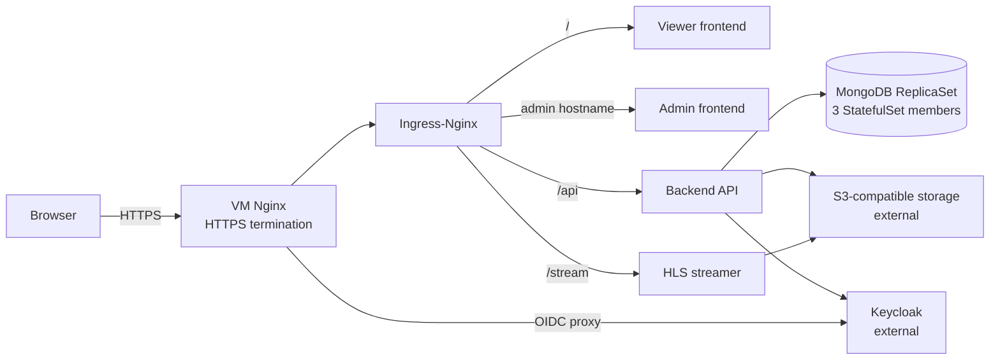
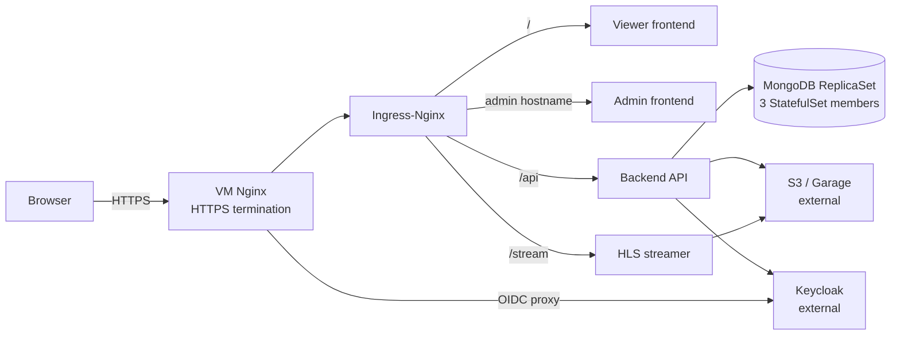

# GINFlix


> Kubernetes platform for a video-on-demand application, designed with GitOps, observability, security, and operational resilience in mind.

GINFlix is a DevOps and Kubernetes infrastructure project developed as part of the GIN207 course.

The original assignment required deploying a prebuilt video-streaming application composed of five services on a Kind cluster while providing external access, reliability, and operational manageability.

This repository goes beyond the minimum requirements by implementing GitOps workflows, observability, DevSecOps controls, automated backups, workload isolation, and operational tooling around the provided application.

> **Important**
>
> The application source code, frontend, backend, streamer implementation, and private container images are **not included in this repository** because they were provided through the academic project environment and are not owned by the repository maintainers.
>
> This repository focuses on the Kubernetes platform, deployment automation, security controls, infrastructure architecture, and operational practices required to run the application reliably.

## Highlights

- 5-service video-on-demand platform
- MongoDB ReplicaSet (3 members)
- GitOps deployment with Argo CD
- HPA and PodDisruptionBudgets
- NetworkPolicies for workload isolation
- Prometheus + Grafana + Loki observability
- Automated MongoDB backups
- GitHub Actions CI/CD and DevSecOps validation

## Project Overview

GINFlix delivers a Netflix-style video-on-demand platform consisting of:

- Viewer frontend for browsing and watching content
- Administrative frontend for authenticated video management
- Backend API for metadata management and video processing
- HLS streaming service
- MongoDB storage layer

The platform was deployed in a Kind-based Kubernetes environment and enhanced with high-availability, observability, security, GitOps, and operational features commonly found in production platforms.

## Beyond the Original Assignment

The original course requirements focused on:

- Deploying the application on Kubernetes
- Exposing application services
- Keeping MongoDB internal
- Providing a reliable deployment

Additional functionality implemented in this project:

| Area | Enhancement |
| --- | --- |
| GitOps | Argo CD + Kustomize |
| Observability | Prometheus, Grafana, Loki, Promtail |
| Resilience | HPA, PodDisruptionBudgets, Anti-Affinity |
| Security | NetworkPolicies, Kubescape, kube-score |
| DevSecOps | Trivy, Gitleaks, OpenSSF Scorecard |
| Operations | Backup automation and operational runbooks |
| CI/CD | GitHub Actions validation pipelines |
| Database | MongoDB ReplicaSet with persistent volumes |
| Documentation | Architecture, deployment, security, and operational guides |

## Architecture





The deployment uses a VM-level Nginx reverse proxy because the Kubernetes cluster runs on Kind. Public HTTPS traffic terminates on the VM and is forwarded to Ingress-Nginx running inside the cluster.

MongoDB remains cluster-internal, while Keycloak and S3-compatible storage are external services provided by the academic environment.

Additional architectural details are available in [docs/architecture.md](docs/architecture.md).

## Technology Stack

| Area | Technology |
| --- | --- |
| Container Platform | Kubernetes, Kind |
| GitOps | Argo CD, Kustomize |
| Ingress | Ingress-Nginx |
| Reverse Proxy | Nginx |
| Database | MongoDB ReplicaSet |
| Identity | Keycloak |
| Storage | S3-compatible Garage |
| Video Delivery | HLS |
| Autoscaling | HPA, Metrics Server |
| High Availability | PodDisruptionBudgets, Anti-Affinity |
| Monitoring | Prometheus, Grafana |
| Logging | Loki, Promtail |
| Security Analysis | Kubescape, kube-score, Trivy |
| Secret Management | Kubernetes Secrets |
| CI/CD | GitHub Actions |

## Key Features

### Kubernetes Platform

- Dedicated namespace architecture
- Deployments for stateless workloads
- StatefulSet-based MongoDB deployment
- Persistent volumes and storage management
- Ingress-based routing
- Readiness and liveness probes
- Resource requests and limits

### High Availability

- Two frontend replicas
- Two admin frontend replicas
- Backend and streamer HPAs: 2–5 replicas at 50% average CPU utilization
- MongoDB three-member replica set
- Pod anti-affinity
- PodDisruptionBudgets
- Persistent storage

### GitOps and CI/CD

- Argo CD automated synchronization
- Kustomize application bundle
- GitHub Actions validation workflows
- GitHub Actions security workflows
- Release automation

### Security Checks

- NetworkPolicies for workload isolation
- Internal-only MongoDB exposure
- Private registry authentication
- Security scanning with Gitleaks, Trivy, Kubescape, kube-score, and OpenSSF Scorecard
- Safe placeholder templates are included; real credentials are excluded from version control
- TLS support through Nginx and cert-manager resources

### Observability

- Prometheus metrics collection
- Grafana dashboards
- Loki centralized logging
- Promtail log shipping
- Namespace-focused monitoring design

### Operations

- Automated MongoDB backups
- Replica-set initialization automation
- Operational runbooks
- Troubleshooting guides
- Deployment validation procedures

## Repository Structure

```text
.
├── .gitignore
├── .yamllint
├── README.md
├── docs/
│   ├── architecture.md
│   ├── deployment.md
│   ├── operations.md
│   ├── security.md
│   ├── decisions.md
│   ├── lessons-learned.md
│   └── demo-runbook.md
├── k8s/
│   ├── namespace.yaml
│   ├── app/
│   ├── backend/
│   ├── cert-manager/
│   ├── examples/
│   ├── frontend/
│   ├── frontend-admin/
│   ├── streamer/
│   ├── mongodb/
│   ├── secrets/
│   ├── ingress/
│   ├── hpa/
│   ├── pdb/
│   ├── network-policies/
│   ├── monitoring/
│   ├── gitops/
│   └── security-reports/
│
├── reverse-proxy/
│
└── .github/
    ├── ISSUE_TEMPLATE/
    └── workflows/
```

## Deployment Overview

The project targets a Kind-based Kubernetes environment running inside a Linux virtual machine.

Prerequisites:

- Docker
- Kind
- kubectl
- Helm
- Ingress-Nginx
- Metrics Server
- LoadBalancer implementation (MetalLB or equivalent)
- Access to the course container registry
- External Keycloak service
- External S3-compatible storage

High-level deployment process:

1. Create the `ginflix` namespace.
2. Configure environment-specific Secrets.
3. Deploy MongoDB StatefulSet.
4. Initialize MongoDB replica set.
5. Deploy application workloads.
6. Apply NetworkPolicies, HPAs, and PodDisruptionBudgets.
7. Configure Ingress resources.
8. Configure VM-level Nginx reverse proxy.
9. Validate application functionality.

A detailed deployment procedure is available in:

- `docs/deployment.md`

## Repository Scope

This repository maintains:

- Kubernetes manifests
- Argo CD resources
- Kustomize configuration
- HPA and PDB configuration
- NetworkPolicies
- Monitoring configuration
- Security tooling
- CI/CD automation
- Reverse-proxy configuration
- Operational scripts
- Documentation

The following components are external and are **not distributed** through this repository:

- Application source code
- Frontend application
- Backend application
- Streamer implementation
- Private application container images
- Keycloak deployment
- S3-compatible storage infrastructure

These components were provided as part of the academic environment.

## Monitoring and Security

Monitoring installation, dashboards, and operational procedures are documented in:

- `docs/operations.md`

Security architecture, policy implementation, and security scanning workflows are documented in:

- `docs/security.md`

## GitHub Actions

The repository includes automated workflows for:

### Validation

- Kubernetes schema validation
- Kustomize rendering validation
- YAML linting
- Shell script linting

### Security Workflow

- Gitleaks
- Trivy
- kube-score
- Kubescape
- OpenSSF Scorecard

### Releases

- Automated GitHub releases for version tags

## Documentation

| Document | Purpose |
| --- | --- |
| architecture.md | System architecture and networking |
| deployment.md | Installation and deployment procedures |
| operations.md | Monitoring and day-to-day administration |
| security.md | Security controls and assessments |
| demo-runbook.md | End-to-end validation procedure |
| decisions.md | Architectural decisions and trade-offs |
| lessons-learned.md | Engineering challenges and solutions |

## Lessons Learned

Some of the main engineering lessons from the project include:

- Stateful applications require different operational patterns than stateless workloads.
- MongoDB availability depends on stable identities and persistent storage.
- GitOps simplifies long-term cluster management.
- NetworkPolicies are easier to maintain when accompanied by validation tests.
- Observability should be planned from the beginning rather than added after deployment.
- Operational procedures and runbooks are as important as infrastructure manifests.
- Kind introduces networking constraints that require additional reverse-proxy configuration.

Additional details are available in `docs/lessons-learned.md`.

## Project Status

This repository represents the final state of a completed academic DevOps project.

Although the platform was designed for an educational Kind-based environment, many implemented practices mirror those used in production Kubernetes environments:

- GitOps deployment management
- Infrastructure validation
- Security scanning
- Application observability
- Backup automation
- High-availability design patterns
- Operational documentation

Some environment-specific dependencies remain external:

- Private application images
- Keycloak identity service
- S3-compatible storage
- Course infrastructure

As a result, this repository should be considered a Kubernetes Platform Engineering and DevOps showcase rather than a fully self-contained application.

## License

This repository contains infrastructure configuration, documentation, and operational tooling created for educational purposes.

Third-party applications, container images, and external services referenced by this repository remain the property of their respective owners and are not redistributed here.
