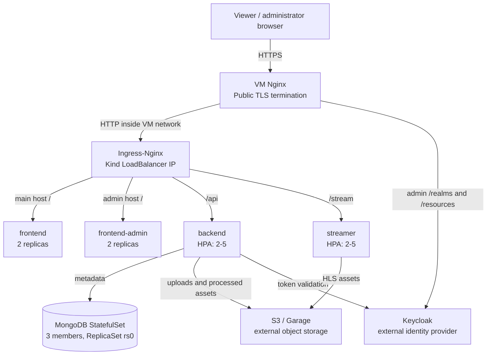

# Architecture

GINFlix deploys a prebuilt five-service video-on-demand application to a Kind cluster running on a VM. S3-compatible object storage (Garage) and Keycloak are external dependencies provided by the course environment.

## Context and Components

## Why VM Nginx Is in Front of Ingress

The cluster uses Kind, whose LoadBalancer address is reachable from the VM but is not a public ingress point for browsers outside the VM. Nginx on the VM provides the public-facing endpoint, terminates HTTPS with the VM certificates, and forwards HTTP traffic to Ingress-Nginx.

The admin domain has a further limitation: browsers use the admin host for OIDC callbacks, while Keycloak is hosted separately. VM Nginx proxies Keycloak's `/realms/` and `/resources/` paths and rewrites host-related response details.

## Routing

| Host | Path | Destination |
| --- | --- | --- |
| Main site | `/` | `frontend:80` |
| Main site | `/api` | `backend:8080` |
| Main site | `/stream` | `streamer:8080` |
| Admin site | `/` | `frontend-admin:80` |
| Admin site | `/api` | `backend:8080` |
| Admin site | `/stream` | `streamer:8080` |
| Admin site | `/realms/`, `/resources/` | Keycloak through VM Nginx |

Application Services use ClusterIP. MongoDB uses a headless ClusterIP Service and is not exposed externally.

## Request and Data Flows

### Browse and Play

1. The browser loads the viewer frontend.
2. The frontend requests video metadata from `/api`.
3. The backend reads metadata from MongoDB.
4. The frontend requests an HLS playlist and segments from `/stream`.
5. The streamer reads HLS assets from S3/Garage and returns them to the browser.

### Upload

1. An administrator authenticates through Keycloak using the admin-host reverse proxy.
2. The admin frontend sends an authorized upload request to `/api`.
3. The backend validates the token and processes the uploaded video.
4. The backend writes processed assets and thumbnails to S3/Garage and metadata to MongoDB.
5. The streamer serves the new HLS content to viewers.

## Stateful Data and Availability

MongoDB runs as a three-member StatefulSet replica set (`rs0`), with stable Pod identities and one PVC per member. A one-shot Job initializes the replica set. This design provides database replication; a three-replica Deployment without replica-set configuration would create independent databases rather than a highly available database.

Stateless frontends use two replicas. Backend and streamer use HPAs with a minimum of two and maximum of five replicas, targeting 50% average CPU utilization. PDBs and preferred pod anti-affinity improve availability during voluntary disruptions and scheduling, but they do not replace backups or a multi-zone production cluster.

## Key Configuration

`ginflix-config` provides public application settings, including Keycloak identifiers and relative frontend paths (`/api`, `/stream`). Kubernetes Secrets provide MongoDB, S3, and private-registry credentials. Real credentials are not stored in the repository.
